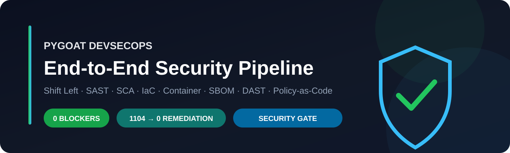
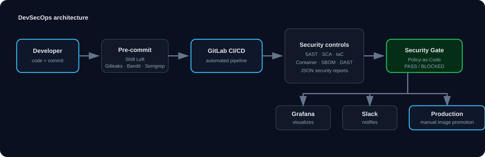
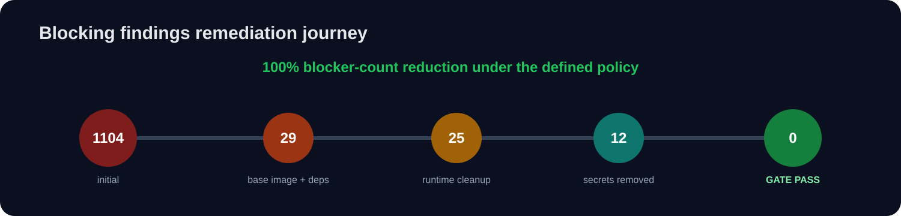
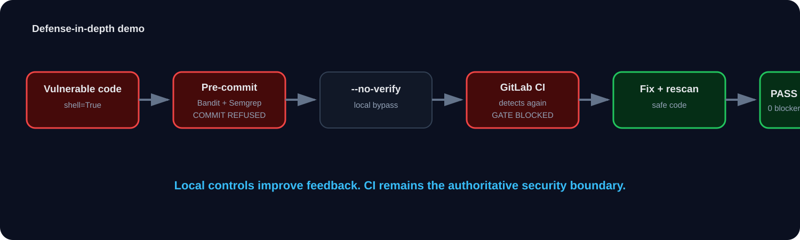

<p align="center">
  
</p>

<h1 align="center">PyGoat DevSecOps — End-to-End Security Pipeline</h1>

<p align="center">
  <strong>From a green-but-unsecured CI/CD pipeline to a policy-driven DevSecOps release process.</strong>
</p>

<p align="center">
  
  
  
  
</p>

<p align="center">
  
  
  
  
</p>

---

## Recruiter quick view

This final-year cybersecurity engineering project transforms [PyGoat](https://github.com/adeyosemanputra/pygoat), an intentionally vulnerable Django application, into an **end-to-end DevSecOps security workflow**.

| What I built | Outcome |
|---|---|
| Shift-left developer controls | Gitleaks, Bandit, Semgrep and private-key checks before commit |
| Multi-layer CI security | Secrets, SAST, SCA, IaC, container, SBOM and DAST |
| Centralized release decision | Policy-as-Code **Security Gate** with fail-secure behavior |
| Remediation program | **1104 → 29 → 25 → 12 → 0 blocking findings** |
| Security observability | Grafana Cloud dashboard with history and trends |
| Team notifications | Slack alerts for authorized / blocked / promoted releases |
| Governance | Time-limited, auditable false-positive exceptions |
| Release control | Manual promotion of a validated Docker image to `:production` |

> **Scope, stated honestly:** this is a university / portfolio implementation, built and run on GitLab CI/CD. It is not enterprise production experience. PyGoat remains an intentionally vulnerable training application; some lab content is intentionally retained as non-blocking educational material.

---

## Architecture

<p align="center">
  
</p>

### Core design principle

> **Scanners detect → Security Gate decides → Grafana visualizes → Slack notifies.**

The release decision is never delegated to Grafana or Slack. The authoritative decision comes from the Security Gate, which evaluates scanner evidence against a versioned security policy.

---

## Security workflow

```text
Developer
   │
   ├── git commit
   ▼
Pre-commit / Shift Left
   ├── private-key detection
   ├── Gitleaks
   ├── Bandit
   └── Semgrep
   │
   ├── git push
   ▼
GitLab CI/CD
   ├── secrets
   ├── SAST
   ├── dependency / SCA
   ├── IaC
   ├── build + tests
   ├── Docker package
   ├── container scan
   ├── SBOM
   └── DAST on ephemeral staging
   ▼
Security Gate
   ├── PASS    → release technically authorized
   └── BLOCKED → production promotion refused
   │
   ├── Grafana → observability
   └── Slack   → notification
   ▼
Manual production image promotion
```

---

## Security controls

| Security area | Tool | Purpose | Blocking logic |
|---|---|---|---|
| Secrets | **Gitleaks** | Detect keys, tokens and credentials | Zero tolerance |
| SAST | **Semgrep** | Injection, RCE and insecure patterns | `ERROR` |
| SAST | **Bandit** | Python-specific security issues | `HIGH` with confidence ≥ `MEDIUM` |
| SCA | **Trivy FS** | Known vulnerable dependencies | CVSS ≥ 7.0 / serious fixable vulnerabilities |
| IaC | **Trivy Config** | Docker / configuration weaknesses | HIGH / CRITICAL |
| IaC | **Checkov** | Docker security checks | selected blocking checks |
| Container | **Trivy Image** | OS and library CVEs in final image | policy-based |
| SBOM | **CycloneDX** | Component inventory | evidence / traceability |
| DAST | **OWASP ZAP** | Running application behavior | High risk blocks |

The same developer-facing controls are replayed in CI because a local hook can be bypassed with `git commit --no-verify`.

---

## Policy-as-Code and Security Gate

Two files form the decision core:

- [`ci/security-policy.toml`](ci/security-policy.toml) — versioned blocking thresholds.
- [`ci/security_gate.py`](ci/security_gate.py) — parses reports, normalizes findings and returns **PASS** or **BLOCKED**.

The gate also produces:

- `reports/security-summary.json` — machine-readable source for Grafana and Slack.
- `reports/security-summary.md` — human-readable summary.
- JUnit output — blocking findings visible in GitLab's test view.

### Fail-secure behavior

If expected security evidence is missing or invalid, the pipeline does **not** assume safety.

```text
Missing / malformed security report
              ↓
        insufficient evidence
              ↓
            BLOCKED
```

That design was validated during development when an unrelated test-runner failure prevented downstream security reports from being produced; the gate correctly refused the release.

---

## Remediation journey

<p align="center">
  
</p>

| Snapshot | Blocking findings | Gate |
|---|---:|---|
| Initial baseline | **1104** | BLOCKED |
| Base image + non-root container + dependency remediation | 29 | BLOCKED |
| Runtime packaging cleanup | 25 | BLOCKED |
| Hard-coded secrets removed | 12 | BLOCKED |
| Application findings remediated | **0** | **PASS** |

**Result: 100% reduction in blocker count under the defined security policy.**

This is deliberately **not** presented as “100% secure.” Non-blocking warnings remain visible and tracked.

### Initial blocker distribution

```text
Trivy image   994
Trivy FS       83
Gitleaks       13
Semgrep         8
Bandit          4
Trivy Config    1
Checkov         1
ZAP             0
──────────────────
Total        1104
```

Validated snapshots and provenance are stored in [`monitoring/history/security-history.json`](monitoring/history/security-history.json).

---

## What was remediated

### Container and supply chain
- Migrated to a modern multi-stage `python:3.11-slim-bookworm` image.
- Kept build tooling out of the runtime stage.
- Removed `pip`, `setuptools` and `wheel` from the final runtime image.
- Added a dedicated **non-root** runtime user.
- Upgraded vulnerable dependencies.
- Added a container `HEALTHCHECK`.

### Secrets
- Removed the hard-coded Django `SECRET_KEY`.
- Moved the value to a masked GitLab CI/CD environment variable.
- Derived lab signing keys with `salted_hmac` rather than hard-coded secrets.

### Application security
- Command injection → shell execution removed / safely simulated.
- Unsafe deserialization → signed JSON instead of `pickle.loads()`.
- Unsafe YAML → `yaml.safe_load`.
- `eval()` → safe AST-based handling / explanation.
- Learner-submitted code → parsed as data, never executed.
- SSRF → HTTPS-only public destinations, DNS checks, IP pinning, no unsafe redirects.
- JWT → derived signing key + explicit algorithm.
- Passwords → Django password hashing.
- SSTI → user content stored and rendered strictly as data.
- XSS-related output paths → escaping and CSRF hardening where applicable.

> PyGoat's intentionally vulnerable teaching labs are not all “removed”; the project separates **blocking release risk** from **deliberately retained educational warnings**.

---

## Controlled false-positive exceptions

Disabling an entire scanner would hide future vulnerabilities. Instead, [`ci/exemptions.toml`](ci/exemptions.toml) allows a temporary acceptance of **one exact finding**.

An exception requires:

- exact `control + fingerprint` match;
- owner;
- different approver (**four-eyes principle**);
- ticket reference;
- meaningful justification;
- creation date;
- expiration ≤ 90 days.

An expired exception simply stops applying, so the finding becomes blocking again.

```bash
python -m ci.tests.demo_exemption_workflow
# BLOCKED → EXEMPTED/PASS → expired → BLOCKED
```

**Final baseline: no active real exception.**

More detail: [`docs/devsecops/06-exemptions.md`](docs/devsecops/06-exemptions.md).

---

## Observability and notifications

### Grafana Cloud

[`ci/security_telemetry.py`](ci/security_telemetry.py) transforms the gate summary into OTLP metrics.

The dashboard tracks:

- Gate status: PASS / BLOCKED
- Release status
- Blockers and warnings by control
- Control evidence matrix
- Historical gate results
- Remediation trend
- BEFORE vs AFTER security posture

Dashboard source: [`monitoring/grafana/pygoat-sentinel-dashboard.json`](monitoring/grafana/pygoat-sentinel-dashboard.json)

### Slack

[`ci/slack_notify.py`](ci/slack_notify.py) sends security and release notifications without changing the gate decision.

- 🟢 **RELEASE AUTHORIZED** — gate passed.
- 🔴 **RELEASE BLOCKED** — at least one blocking condition remains.
- 🚀 **PRODUCTION PROMOTED** — validated image manually promoted.

The Slack webhook is stored as a masked / protected GitLab CI variable and is never committed to the repository.

---

## Defense-in-depth live demo

<p align="center">
  
</p>

The project includes a controlled demonstration of why both local security and central CI are required:

1. Introduce `subprocess.run(user_input, shell=True)`.
2. Normal `git commit` → **Bandit + Semgrep block the commit locally**.
3. Deliberately bypass the hook with `--no-verify`.
4. Push to GitLab.
5. CI detects the vulnerability again.
6. Security Gate → **BLOCKED**.
7. Slack → 🔴 release blocked.
8. Fix the code.
9. Pre-commit passes.
10. New pipeline → **PASS**.

> Local controls improve developer feedback. **CI remains the authoritative security boundary.**

The published demo module is the **fixed** version: [`demo/demo_command_injection.py`](demo/demo_command_injection.py).

---

## Production model

In this project, **production means controlled image promotion**, not a public application server.

```text
Security Gate PASS
        ↓
manual deploy:production approval
        ↓
pull validated Docker image
        ↓
tag image as :production
        ↓
push tag to GitLab Container Registry
```

This separates **automated technical validation** from **human release approval**.

---

## Repository map

```text
.gitlab-ci.yml                   GitLab CI/CD pipeline
.pre-commit-config.yaml          shift-left hooks
.gitleaks.toml                   secret detection rules
Dockerfile                       hardened multi-stage image

ci/
├── security-policy.toml         Policy-as-Code thresholds
├── security_gate.py             centralized release decision
├── exemptions.toml              controlled exception register
├── security_telemetry.py        Grafana / OTLP exporter
├── slack_notify.py              Slack notifications
├── scan_checks.py               scanner execution checks
└── tests/                       gate / telemetry / exception tests

monitoring/
├── grafana/                     dashboard definition
└── history/                     validated remediation history

docs/devsecops/                  architecture and governance documentation
demo/                            controlled live-demo module
introduction/, pygoat/           PyGoat application
```

---

## Run locally

```bash
pip install -r requirements.txt

export DJANGO_SECRET_KEY="$(python -c 'import secrets; print(secrets.token_hex(50))')"

python manage.py test
```

For Windows PowerShell, set the environment variable with:

```powershell
$env:DJANGO_SECRET_KEY = python -c "import secrets; print(secrets.token_hex(50))"
python manage.py test
```

---

## Key lessons

- A **green pipeline is not automatically a secure pipeline**.
- Shift Left shortens developer feedback loops, but local hooks are not a trust boundary.
- Multiple scanners are useful only when their results feed a **coherent decision policy**.
- Missing evidence must never be interpreted as “clean.”
- Warnings can remain visible without blocking every delivery.
- False positives need governance, not blanket suppression.
- Observability should explain the decision, not make it.
- Production authorization should remain explicit even after automated security validation.

---

## Attribution and license

The application is **PyGoat**, originally created by its authors and contributors at [adeyosemanputra/pygoat](https://github.com/adeyosemanputra/pygoat), and released under the **MIT License**.

- Original license preserved unchanged: [`LICENSE.md`](LICENSE.md)
- Original upstream README preserved: [`PYGOAT_UPSTREAM_README.md`](PYGOAT_UPSTREAM_README.md)
- The DevSecOps pipeline, Policy-as-Code gate, remediation work, exception governance, observability and notification layers were added as part of this university project.
- This GitHub repository is a **clean portfolio snapshot** and intentionally excludes the original development Git history.

---

<p align="center">
  <strong>DevSecOps work by Abdelhak Abrougui</strong><br>
  <a href="https://github.com/abdelhak003">@abdelhak003</a>
</p>
