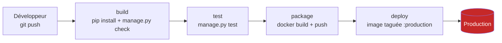

# 01 — État des lieux « AS-IS » du pipeline DevOps

> **Consignes couvertes :** R2.1 (cartographie), R2.2 (outils en place), R2.3 (points faibles), R2.4 (état as-is documenté avant modification) — critère E1.
> **Version analysée :** tag git [`v0-as-is`](../../../-/tags/v0-as-is) — fichier `.gitlab-ci.yml` v0.
> **Date du relevé :** 06/10/2026.

---

## 1. Contexte

- **Application :** [PyGoat](https://github.com/adeyosemanputra/pygoat) (projet OWASP, licence MIT), application web **Python / Django** avec base **SQLite**, conteneurisée avec **Docker**.
- **Choix :** application volontairement vulnérable → elle contient de vraies failles de l'OWASP Top 10, ce qui permet de démontrer que chaque contrôle DevSecOps **détecte** puis que la correction **fait passer** le pipeline.
- **Hébergement du code et CI/CD :** GitLab.com (GitLab CI, runners partagés).

## 2. Cartographie du pipeline actuel (R2.1)



| # | Étape | Ce qu'elle fait | Outil | Contrôle de sécurité ? |
|---|---|---|---|---|
| 1 | `build` | Installe les dépendances, compile le Python, vérifie la configuration Django | pip, `compileall`, `manage.py check` | ❌ Aucun |
| 2 | `test` | Lance les tests unitaires Django | `manage.py test` | ❌ Aucun — `introduction/tests.py` est **vide** (0 test) |
| 3 | `package` | Construit l'image Docker et la pousse dans le registre GitLab | Docker (dind) | ❌ Image **jamais scannée** |
| 4 | `deploy` | Promeut l'image au tag `:production` (branche principale uniquement) | Docker | ❌ **Aucune validation** avant la prod |

**Déclenchement :** automatique à chaque push. **Aucune étape ne peut bloquer un code vulnérable** : si le code compile, il part en production.

## 3. Outils déjà en place (R2.2)

| Outil | Où | Rôle | Analyse |
|---|---|---|---|
| **GitLab CI** | `.gitlab-ci.yml` | Pipeline build → deploy | Fonctionnel, mais orienté livraison uniquement |
| **Docker** | `Dockerfile` | Packaging | Voir faiblesses F-IMG ci-dessous |
| **GitHub Actions — Flake8** *(hérité du projet amont)* | `.github/workflows/flake8.yml` | Lint Python | Ne bloque que les erreurs de **syntaxe** ; tout le reste est en `--exit-zero` (non bloquant). Python 3.8 (**fin de vie**). `actions/checkout@v2` obsolète. **Aucune règle de sécurité.** |
| **GitHub Actions — Hadolint** *(hérité)* | `.github/workflows/hadolint.yml` | Lint du Dockerfile | ✅ Bonne pratique : action épinglée par **SHA de commit** (anti supply-chain). ⚠️ Étape dupliquée (scanne 2 fois le même fichier). **Ne s'exécute pas sur GitLab.** |

## 4. Points faibles de sécurité (R2.3)

Mesures relevées en local avec les outils qui seront intégrés au pipeline (voir §6 pour reproduire).

| ID | Faiblesse | Preuve mesurée | Risque | Contrôle « to-be » prévu |
|---|---|---|---|---|
| F-SEC | **Aucun scan de secrets** | Gitleaks : **27** secrets dans l'historique git, **10** dans les fichiers actuels ; `SECRET_KEY` Django en dur (`pygoat/settings.py:25`) **non détecté** par les règles par défaut | Vol de session, falsification de cookies, accès aux API | `secrets_scan` (Gitleaks + règle perso, TruffleHog) + pre-commit |
| F-SAST | **Aucune analyse statique** | Bandit : **48** (4 HIGH, 12 MEDIUM) · Semgrep : **32** (8 ERROR) — `eval()`, `pickle.loads`, `shell=True`, `yaml.load`, SQL concaténé, MD5 | RCE, injection SQL / commande | `sast` (Semgrep, Bandit, SonarCloud) + SonarLint IDE |
| F-SCA | **Dépendances non vérifiées** | Trivy : **183 CVE** dont **10 CRITICAL** et **61 HIGH** (Django 4.2, Pillow 9.4, PyJWT 2.4, PyYAML 5.1, urllib3, sqlparse…) | Exploitation de failles publiques connues | `scan_dependencies` (Trivy, Grype, RetireJS) |
| F-IMG | **Image Docker non scannée et non durcie** | Base `python:3.11.0b1-buster` = Python **bêta** + Debian 10 **en fin de vie** ; conteneur exécuté en **root** (Trivy DS-0002, HIGH) ; pas de `HEALTHCHECK` | Évasion / escalade, CVE système non corrigées | `docker_scan` (Trivy, Grype) + `iac_scan` (Checkov, Hadolint) |
| F-DAST | **Aucun test dynamique** | Application jamais testée en fonctionnement ; `DEBUG = True` en dur | XSS, en-têtes manquants, fuite d'information | `dast` (OWASP ZAP, Nikto) sur un staging |
| F-GATE | **Aucune quality gate** | `deploy` s'exécute dès que `package` réussit | Toute vulnérabilité atteint la production | `security_gate` (seuils CVSS) + prod en validation manuelle |
| F-TEST | **Tests inexistants** | `introduction/tests.py` vide → le job `test` est vert sans rien tester | Fausse confiance (« pipeline vert = sûr ») | Tests de sécurité unitaires |
| F-LOCAL | **Rien côté développeur** | Pas de pre-commit, pas de règles IDE | Failles et secrets poussés sans alerte | Shift-left : SonarLint, Semgrep, pre-commit |
| F-REPORT | **Aucun reporting / alerte / historique** | Aucun rapport, aucune notification | Personne n'est prévenu, pas de suivi dans le temps | Rapports HTML/JSON, SonarCloud, Slack, tableau de bord |
| F-SUPPLY | **Chaîne d'approvisionnement non tracée** | Pas de SBOM, image non signée, tag de base mutable | Impossible de savoir si on est touché par une nouvelle CVE (cf. Log4Shell) | `sbom` (Syft), signature (Cosign) |

> **Le message clé de l'état as-is :** le pipeline est **vert** ✅… alors que l'application contient des centaines de vulnérabilités. *Un pipeline vert sans contrôles de sécurité ne prouve rien.*

## 5. Synthèse chiffrée (référence pour la comparaison avec le « to-be »)

| Indicateur | AS-IS |
|---|---|
| Contrôles de sécurité dans le pipeline | **0** |
| Étapes capables de bloquer un déploiement pour raison de sécurité | **0** |
| Secrets détectables (historique / actuels) | 27 / 10 |
| Findings SAST (Bandit + Semgrep) | 48 + 32 |
| CVE dans les dépendances (CRITICAL / HIGH) | 183 (10 / 61) |
| Conteneur exécuté en root | Oui |
| Tests unitaires | 0 |
| Rapports / notifications / historique | Aucun |

## 6. Reproduire les mesures (O4 — documentation reproductible)

Depuis la racine du dépôt, sur le tag `v0-as-is` :

```bash
git checkout v0-as-is
gitleaks git . --report-path gitleaks.json          # secrets, tout l'historique
gitleaks dir . --report-path gitleaks-dir.json      # secrets, fichiers actuels
bandit -r . -x ./challenge,./dockerized_labs,./Solutions -f json -o bandit.json
semgrep scan --config p/python --config p/django --config p/secrets \
        --exclude challenge --exclude dockerized_labs --exclude Solutions --json -o semgrep.json
trivy fs --scanners vuln,misconfig --format json -o trivy.json .
```

Versions utilisées : Gitleaks 8.30.1 · Bandit 1.9.4 · Semgrep 1.179.0 · Trivy 0.75.0.

**Périmètre :** les dossiers `challenge/`, `dockerized_labs/` et `Solutions/` sont des labs pédagogiques indépendants, exclus de l'analyse applicative (décision tracée dans le processus d'exemption).
